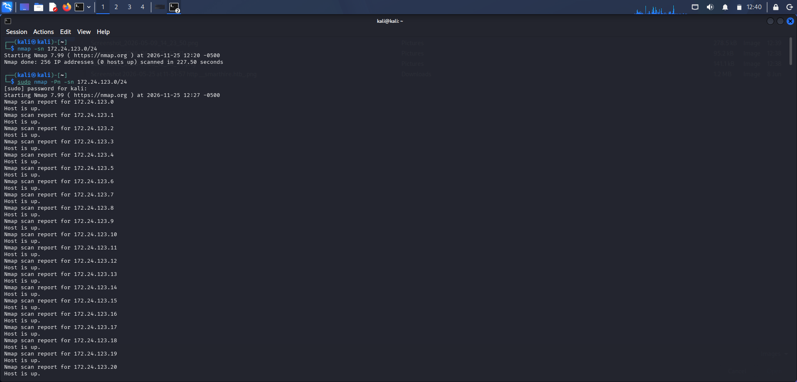
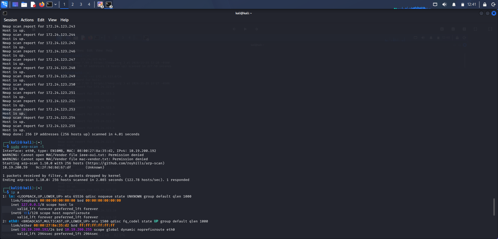
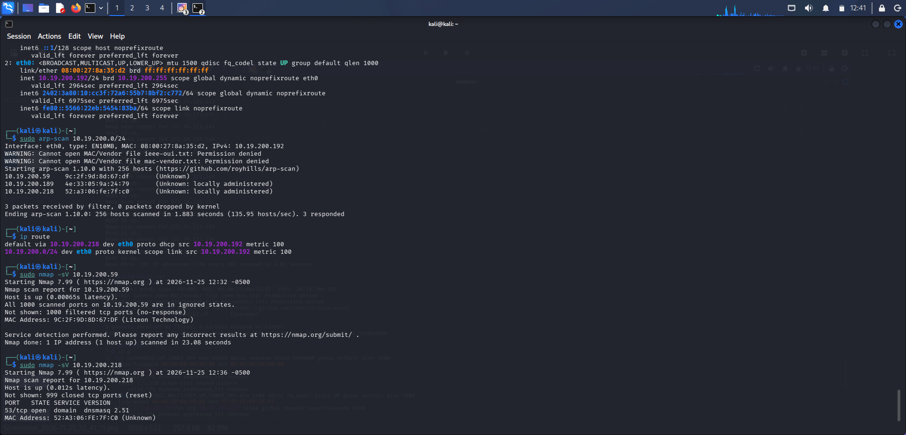
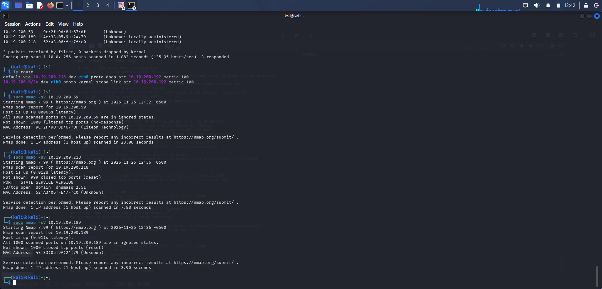

# 🔐 Network Security Audit

Network Security Audit using Nmap & ARP-Scan - Portfolio Project by Heera

## 📋 About This Project
This project is a basic network security audit performed on my home network to identify connected devices, open ports, and potential security risks using Nmap and ARP-Scan.

## 🛠️ Tools Used
- Nmap - For Port Scanning & Device Discovery
- ARP-Scan - For Finding Devices on Local Network
- Kali Linux / Windows

## 🔍 What I Did
1. Scanned the local network to find all connected devices using ARP-Scan
2. Used Nmap to scan for open ports and running services
3. Analyzed the results to find security risks
4. Created a detailed audit report with findings

## 📸 Screenshots

### Network Scan Results

## 📄 Full Report
Full detailed report available here: [Network_Audit_Nmap_ARP-Scan_Report.pdf](Network_Audit_Nmap_ARP-Scan_Report.pdf)

## 👩‍💻 Author
**Heera**
Aspiring Cybersecurity Analyst
